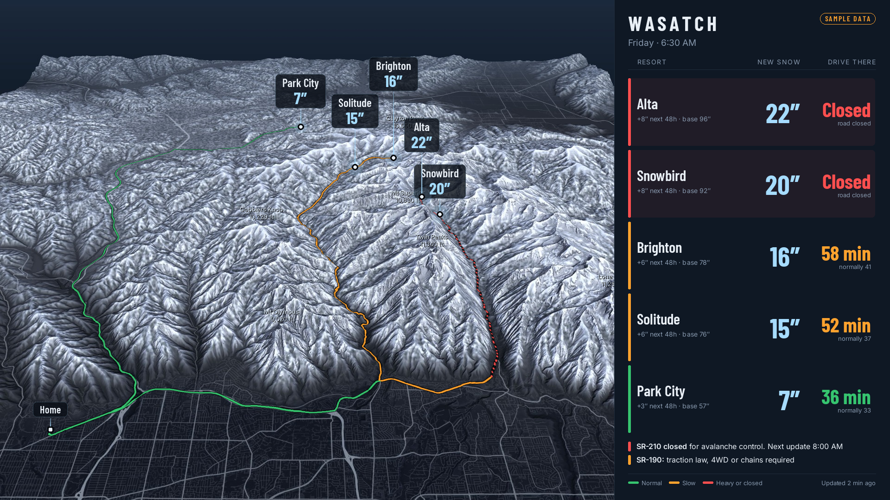

# Wasatch wall display

A wall-mounted Raspberry Pi display showing a 3D view of the central Wasatch from the Salt Lake valley, with new snow at Alta, Snowbird, Brighton, Solitude and Park City, and the drive from home colored green, orange or red by traffic.

It's a plain Python program. There's no browser and no website, and it keeps working if the internet drops (it just shows the last numbers it got).

**It runs on a cheap Pi.** The camera never moves, so the 3D mountains are drawn once ahead of time and saved as pictures (`assets/prerendered/`). The Pi only paints the road colors and the panel on top, which a Raspberry Pi 4 or Pi 5 with 2 GB handles easily. A `--3d` mode draws the mountains live instead, if you have a Pi 5 and want to play with the camera.



> Right now the numbers are **sample data**. Live snow and traffic are the next milestone.

## How it works

| Piece | File | What it does |
| --- | --- | --- |
| Settings | `wasatch_display/config.py` | Resorts, normal drive times, camera angle, colors. Change things here. |
| Data | `wasatch_display/data.py` | Snow, drive times and road traffic. Sample situations for now. |
| Light map (default) | `wasatch_display/light.py` | Shows the pre-rendered mountains and paints each route in its traffic color. No 3D work. |
| Pre-render | `wasatch_display/prerender.py` | Draws the 3D view once and saves the pictures the light map uses. |
| 3D map | `wasatch_display/terrain.py` | Builds the mountains from real elevations and draws them with OpenGL (used by the pre-render and by `--3d`). |
| Panel and pins | `wasatch_display/overlay.py` | Draws the resort list, the resort pins and peak names with pygame. |
| Main program | `wasatch_display/app.py` | Opens the screen, redraws when something changes, handles keys. |
| Map data | `assets/terrain/`, `assets/prerendered/` | Elevation grid, ground picture, real road routes from home, and the pre-rendered view. |

The 3D map in one paragraph: `heights.npy` is a grid of real elevations (one number every ~70 m). The program turns it into a sheet of about 870,000 triangles and bends it up and down by those heights. `color.jpg` (snow, trees, rock, shading and the grey street grid, about 15 m per pixel) is stretched over it like a decal. The traffic routes are painted onto that picture in their current colors, so they follow the canyon floors exactly. A virtual camera floats over the valley, looks east and tilts 55° down from straight overhead.

## Try it on your laptop

You need Python 3.10 or newer.

```bash
git clone https://github.com/colinetluca-oss/skiwasatch-display.git
cd skiwasatch-display
python3 -m venv .venv            # a private box for this project's libraries
source .venv/bin/activate        # (Windows: .venv\Scripts\activate)
pip install -r requirements.txt
python -m wasatch_display --windowed
```

Keys: **1** to **4** switch between sample days (powder Saturday, bluebird Tuesday, Sunday drive home, avalanche closure), **D** flips the drive direction, **Esc** quits.

Draw a single picture without opening a window:

```bash
python -m wasatch_display --screenshot test.png --demo closed
```

## Set up the Raspberry Pi

1. Flash **Raspberry Pi OS (64-bit, with desktop)** onto the microSD card with Raspberry Pi Imager. In Imager's settings, set the username to `pi`, your Wi-Fi, and turn on SSH.
2. Boot the Pi with the monitor attached, then from your laptop: `ssh pi@raspberrypi.local`
3. On the Pi:

   ```bash
   sudo apt update && sudo apt install -y git python3-venv
   git clone https://github.com/colinetluca-oss/skiwasatch-display.git
   cd skiwasatch-display
   python3 -m venv .venv
   .venv/bin/pip install -r requirements.txt
   DISPLAY=:0 .venv/bin/python -m wasatch_display
   ```

   The monitor should show the display. Press Esc on a keyboard plugged into the Pi to quit, or Ctrl+C in the SSH window.

### Start it automatically

```bash
sudo cp systemd/wasatch-display.service /etc/systemd/system/
sudo systemctl daemon-reload
sudo systemctl enable --now wasatch-display
```

`systemd` is the part of Linux that starts programs at boot. With `Restart=always`, if the display ever crashes it comes back by itself 5 seconds later. To see what it printed: `journalctl -u wasatch-display -f`.

## Changing the camera

The camera angle lives in `wasatch_display/config.py` (`PITCH_DEGREES`, `FIELD_OF_VIEW`) and the framing in `Terrain.camera()`. After changing them, redraw the saved pictures on any computer with a graphics card:

```bash
python -m wasatch_display.prerender --size 1920x1080
```

Then copy `assets/prerendered/` to the Pi (or commit it and `git pull` on the Pi).

## Not tested on a Pi yet

This was built and checked on a regular Linux computer. The default light mode only uses pygame and numpy, so it should run as is. Expect to fix a few small things the first time it runs on the real hardware:

- If the screen stays black, try `SDL_VIDEODRIVER=x11` or `SDL_VIDEODRIVER=wayland` in front of the command.
- `--3d` needs OpenGL 3.1, which the Pi 5 has. On a Pi 4 stick with the default light mode.

## Where the map data comes from

- **Elevation:** [AWS Terrain Tiles](https://registry.opendata.aws/terrain-tiles/) (Mapzen/Tilezen, built from USGS data), zoom 13.
- **Roads:** [Overture Maps](https://overturemaps.org/) transportation data, which includes OpenStreetMap data (© OpenStreetMap contributors, ODbL). The routes from home are the fastest paths on that road network.
- **Fonts:** Barlow Condensed and Inter, both under the SIL Open Font License.

The scripts in `tools/` rebuild `assets/terrain/` from those sources. You only need them if you change the area, home address or look of the terrain.

## Next milestones

1. Live snow from Open-Meteo (no sign-up needed) and SNOTEL.
2. Live drive times and road traffic from Mapbox (free account and key).
3. Canyon closures and traction laws from UDOT.
4. Turn the screen off overnight.
